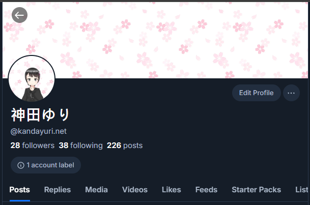

#	Twitter 複合發文功能

一鍵把貼文發到 Twitter 和 Bluesky

#	安裝方法

1.	下載擴充檔案 [`link`](https://github.com/KagariET01/Bluesky-Quick-Poster/releases/download/v0-0-3/Bluesky-Quick-Poster-v0-0-3.crx)
2.	打開擴充管理頁面
	-	[`Google Chrome`](chrome://extensions/)
3.	將擴充檔案丟到 `2.` 的擴充管理頁面
	1.	如果系統提示提示這是不安全的擴充功能，請點擊該擴充功能旁的 `...` -> `保留此擴充功能`
4.	登入 Bluesky 並打開 [`App Password 管理介面`](https://bskyapp.kandayuri.net/settings/app-passwords)
5.	點擊 `Add App Password`
6.	~~名稱隨便填，只要你能分辨誰是誰就好，因為就連開發者都還來不及取名~~  
	（`Allow access to your direct messages` 可勾可不勾，不影響整體功能）  
	接者點 `Next`
7.	將顯示出來的 App Password 複製下來  
	小心：該密碼只會出現一次，關掉後就永遠不會再次顯示，只能回 `5.` 重新申請  
	小心：擁有此 App Password 的人可以直接用你的帳號做任何事情，請不要交給其他任何人（包括你最信任的朋友也不能給）
8.	點右上角的 `擴充功能` 按鈕 -> `Bluesky Quick Poster`
9.	輸入你的帳號ID和 `7.` 產生的 App Password  
	-	關於帳號ID：打開個人頁面，頭像下方，開頭有 `@` 的那串就是帳號ID  
		
10.	點擊 `儲存並連接` 按鈕

#	使用方法

1.	打開 [`Twitter`](https://x.com)
2.	在建立貼文時，你可以在左下角選擇要把貼文傳送到哪些社交平台
3.	如果按 `Ctrl+Enter` 快速鍵貼文，則會同時發送到 Twitter 和 Bluesky（不論你左下角怎麼選擇）

#	使用範圍

-	Twitter
	-	建立新貼文
		-	建立串文（多篇貼文串在一起，並同時發送）
		-	附上圖片
		-	Create Repost
		-	Create Quote

#	未來方向

以下是未來想達成的功能，先把坑挖了，以後慢慢來補  
如果你也想一起來挖坑補坑，請聯絡 [`@神田ゆり`](https://me.kandayuri.net)

-	擴充本身
	-	新增多帳號支援
	-	新增設定頁面
	-	新增更多SNS支援
	-	更好的UI介面、UI切版（以適應多帳號、多SNS、設定頁面）
-	Twitter
	-	自動拆成 Quote（如果用藍勾勾發長文）
